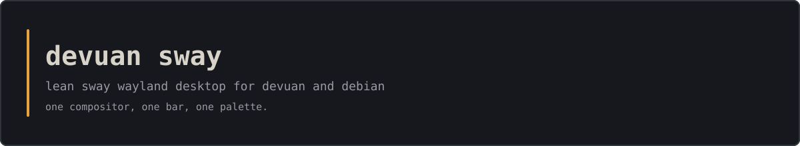

# SwaySetup

stands up a lean sway wayland desktop on a thinkpad-class laptop running devuan 6 or debian 13, with one compositor, bar, notifier, launcher and terminal.

[read the quick start](#quick-start)

| | |
| --- | --- |
| **session** | sway is the default lightdm session on openrc or sysvinit. no systemd. |
| **tools** | one compositor, one bar, one notifier, one launcher and one terminal. |
| **theme** | a 12-palette theme engine and one `swayctl` command. |
| **verify** | `./install.sh --verify` audits the end state without writing. |

## Quick start

```bash
git clone https://github.com/SOSMLG/DevuanSway.git
cd DevuanSway
./install.sh
```

`install.sh` is the unattended wrapper. Log out after it finishes and choose
**SwaySetup** in the LightDM greeter.

For a step-by-step run:

```bash
./install.sh                       # interactive
./install.sh --list                # show steps, phases and defaults
./install.sh --phase core,desktop  # minimal desktop
./install.sh --only firefox        # a single step
./install.sh --verify              # audit the end state
```

## What it does

- Installs Sway 1.x on Wayland as the default LightDM session, with its own
  D-Bus session bus. XFCE stays available as a manual fallback only.
- Provides `swayctl` for theme, wallpaper, bar, lock, power, clipboard,
  screenshots, sound, networking, toggles, status, updates and doctor checks.
  The old `debsway` name remains as a symlink alias.
- Ships a theme engine with Graphite Amber as the default. Use
  `swayctl theme list` in the running session to see the bundled palettes;
  `swayctl theme set <name>` re-renders Sway, foot, swaync, rofi or wofi,
  wlogout and swaylock.
- Uses Sway's built-in bar. `swayctl bar restart` re-applies it, and
  `~/.config/swaybar/status.sh` supplies JSON blocks.
- Keeps the core lean with `--no-install-recommends`. Engineering tools are
  default-on; apps and utilities are your call.

### Steps

| Phase | Steps |
|---|---|
| core | `10-sway-core.sh`, `11-backports.sh`, `12-user-groups.sh`, `13-hardware.sh`, `14-bluetooth.sh`, `15-codecs.sh`, `16-firefox.sh`, `17-fonts.sh`, `18-butterbash.sh`, `19-fastfetch.sh` |
| desktop | `20-shell-tools.sh`, `21-swayctl-cli.sh`, `22-theme-default.sh` |
| engineering | `30-eng-math.sh`, `31-eng-eda.sh`, `32-eng-matlab.sh` |
| apps | `40-desktop-apps.sh`, `41-timeshift.sh`, `42-opencode-agent.sh`, `43-office-mail.sh`, `44-media.sh`, `45-gaming.sh`, `46-chat.sh`, `47-editors.sh` |
| utils | `50-maintenance.sh`, `51-backup.sh`, `52-skel-export.sh` |

Engineering includes Octave, Jupyter, SciLab/Xcos, Qucs, KiCad and a
`python-control` venv at `~/.local/venv/eng`. Matlab itself comes from
MathWorks as a local `.deb`.

## Options

`install.sh` accepts:

| Option | Meaning |
|---|---|
| `--list` | Print all steps, phases and defaults. |
| `--phase core,desktop` | Run only selected phases. |
| `--only <name>` | Run one step or an old-name alias. |
| `--yes`, `-y` | Answer every prompt with its default. |
| `--full` | Answer yes to everything. |
| `--minimal` | Run core and desktop only. |
| `--verify` | Run the read-only end-state audit. |
| `--no-update` | Skip the runner's apt lists refresh. |

`DEBSWAY_ASSUME_YES=1`, `DEBSWAY_PRIV=doas|sudo` and `SWAY_THEME=<name>` are
also honored.

### `swayctl` in one breath

```text
swayctl menu|launcher|run             app launcher / runner / palette
swayctl theme set <name>              switch palette (12 installed)
swayctl bg panel|cycle|random         wallpaper
swayctl bar restart                   re-apply the built-in swaybar
swayctl power|lock                    wlogout grid / themed swaylock
swayctl clip pick                     clipboard history
swayctl shot full|area|annotate|record
swayctl sound up|down|mute            with swaync OSD popup
swayctl wire panel                    nm-connection-editor
swayctl toggle night|dnd|touchpad|layout
swayctl keys                          keybinding cheat sheet
swayctl status media|layout|updates   bar module backends
swayctl eng octave|jupyter|scilab|qucs|kicad|matlab|venv
swayctl update [--apply]              apt and flatpak
swayctl doctor                        read-only session health check
swayctl setup                         first-run wizard
```

See [QUICKSTART.md](QUICKSTART.md) for keybindings and everyday tasks.

## Verification

```bash
./verify.sh
./install.sh --verify
```

The verifier is read-only. It checks groups, packages, `swayctl`, the 12-palette
engine, the greeter session, configs and services. It exits nonzero when a
required item is missing.

## Layout

```text
install.sh               step runner (core, desktop, engineering, apps, utils)
install.sh           unattended installer wrapper
verify.sh            read-only end-state audit
swayctl/             CLI router, libraries, templates and 12 palettes
configs/             static user configs for sway, swaybar and friends
scripts/             numbered steps and shared helpers
assets/  butterbash/ bundled extras
QUICKSTART.md        keybindings and daily use
checklist.md         fresh-install smoke test
docs/                troubleshooting and notes
CONTRIBUTING.md      how to change the kit
AGENTS.md            project conventions
CHANGELOG.md         fork history
```

## Extending

- Steps are `scripts/??-*.sh` with `# SWAY_DESC:` and `# SWAY_DEFAULT:` headers.
  They source `scripts/lib/common.sh` for `ask`, `install_pkgs` and `priv`.
- Add a palette by copying a directory under `swayctl/themes/`.
- Add a themed app by dropping a template in `swayctl/themes/_base/tpl/`.
- Escalate through `priv()`, never a bare sudo. Back up before destructive
  writes. Steps must be safe to re-run.

## License

GPL-2.0. See [LICENSE](LICENSE). Vendored components keep their own licenses.

## Related repos

- [DebianSway](https://github.com/SOSMLG/DebianSway): Sway on Debian/Devuan.
- [DevuanDwm](https://github.com/SOSMLG/DevuanDwm): minimal dwm desktop for Devuan.
- [Devuan-Kde](https://github.com/SOSMLG/Devuan-Kde): KDE Plasma on Devuan.
- [devuan-cinnamon-setup](https://github.com/SOSMLG/devuan-cinnamon-setup): Cinnamon on Devuan.
- [XfceMlg](https://github.com/SOSMLG/XfceMlg): XFCE desktop toolkit.

## Repository standard

This repo follows the SOSMLG standard: [contributing](CONTRIBUTING.md), [security](SECURITY.md), [changelog](CHANGELOG.md). Local workflow: [English guide](https://github.com/SOSMLG/.github/blob/main/docs/GIT_GUIDE.md) / [Arabic guide](https://github.com/SOSMLG/.github/blob/main/docs/GIT_GUIDE.ar.md). Visual standard: [theme](https://github.com/SOSMLG/.github/blob/main/docs/THEME.md) / [الطابع البصري](https://github.com/SOSMLG/.github/blob/main/docs/THEME.ar.md).
